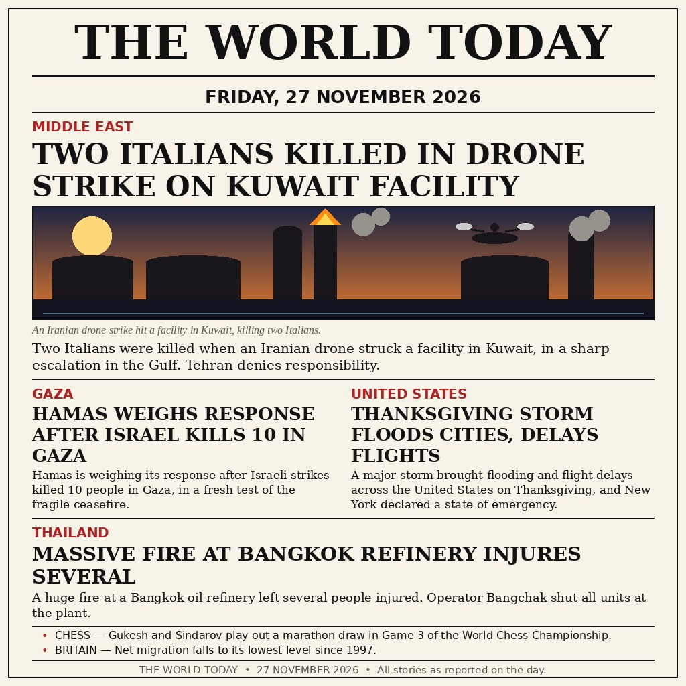

# news-image-20261127 — The World Today, Friday 27 November 2026

[](https://make.fun/c/news-image-20261127)
[](https://make.fun/c/news-image-20261127)
[](https://make.fun/c/news-image-20261127)

A newspaper front page summing up the world news of Friday 27 November 2026
in one image: the drone strike on a Kuwait facility that killed two Italians,
Hamas weighing its response after Israel killed 10 in Gaza, the Thanksgiving
storm flooding US cities and delaying flights, the massive fire at a Bangkok
oil refinery, the marathon draw in Game 3 of the World Chess Championship,
and UK net migration falling to its lowest since 1997.



## How to run

Draw the image (Python 3 with Pillow):

```sh
python3 draw.py
```

Copy it to the output directory (Node 22, standard library only):

```sh
mkdir -p out && MAKEFUN_OUTPUT_DIR=out node main.ts
```

`main.ts` copies the committed `entry.png` to
`$MAKEFUN_OUTPUT_DIR/entry.png` (default `/output`). The image is a
1024x1024 JPEG of at most 1 MiB, and `draw.py` is deterministic: two runs
write identical bytes.

## License

MIT — see [LICENSE](LICENSE).
